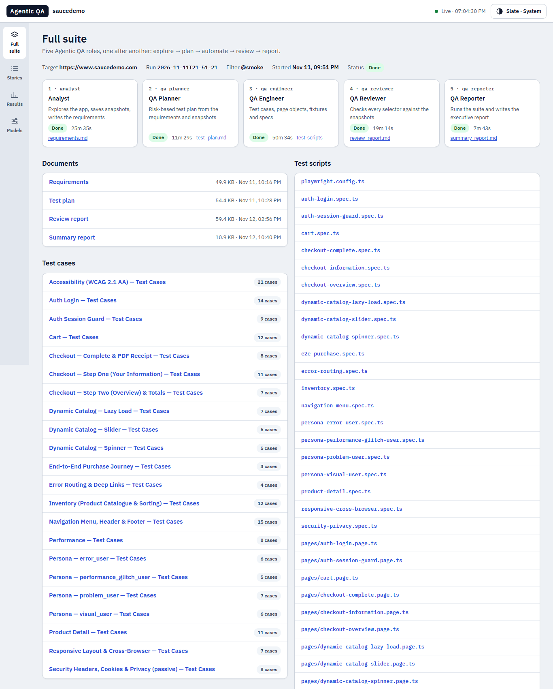
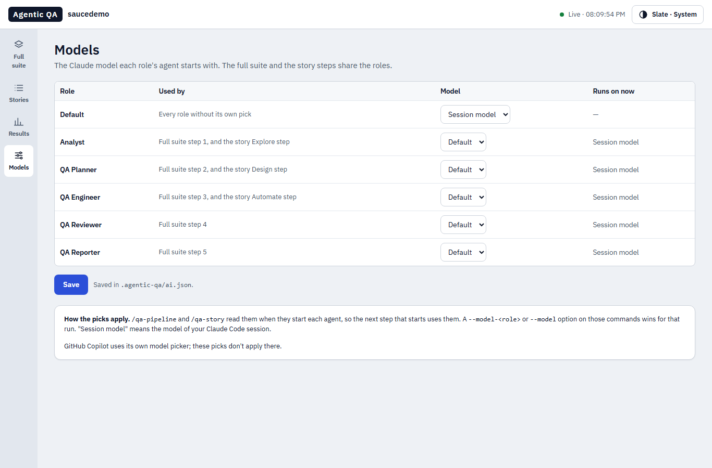

# Agentic QA

Open-source QA agents for **Claude Code** and **GitHub Copilot**, from Agents Forge. Give them a URL and they produce:
- requirements;
- a risk-based test plan;
- test cases;
- a Playwright suite (page objects, fixtures, specs), checked against real page snapshots;
- an executive test report.

They can also work one user story at a time. A small live dashboard shows the progress.

**New here?** Start with the [tutorial](https://qa-crew.github.io/agentic-qa/tutorial/). It covers installing,
setting up, working with the agents in Claude Code or Copilot, and the dashboard, with screenshots. Its source is
[docs/tutorial/index.html](docs/tutorial/index.html).

Agentic QA is the open-source side of [AIQA](https://www.npmjs.com/package/@agents-forge/aiqa), the Agents Forge
product for enterprises. The agents started as AIQA's and come here as plain agent and skill files: no SDK and no
package to install. Both write the same `.aiqa/` files, so you can move to AIQA later (see
[Agentic QA and AIQA](#agentic-qa-and-aiqa)).

## What's inside

**Agents** (`.claude/agents/`)

| Agent | Role | Writes |
|---|---|---|
| `analyst` | Explores the app with playwright-cli and saves an accessibility snapshot of every page | `.aiqa/snapshots/*.yml`, `.aiqa/requirements/requirements.md` |
| `qa-planner` | Risk-based test plan, with priorities taken from what the snapshots show | `.aiqa/test-plan/test_plan.md` |
| `qa-engineer` | Test cases, `playwright.config.ts`, page objects, fixtures and one spec per module; an axe spec and a k6 script when asked | `.aiqa/test-cases/`, `.aiqa/test-scripts/`, `playwright.config.ts` |
| `qa-reviewer` | Checks every selector against the snapshots, and the traceability from test plan to spec | `.aiqa/reports/review_report.md` |
| `qa-reporter` | Runs the suite (smoke, Chromium by default), captures failures, writes the report | `.aiqa/reports/summary_report.md` |
| `story-designer` | One story → testable acceptance criteria and manual test cases | `.aiqa/test-cases/<KEY>-<name>.md` |
| `story-explorer` | Walks those cases in the real app, saves snapshots, marks each case Verified / Updated / Possible defect… | the same file, `.aiqa/snapshots/<KEY>/` |
| `story-automator` | Playwright tests for the verified cases, tagged `@<KEY>` | `.aiqa/test-scripts/<KEY>-<name>.spec.ts` |

**Skills** (`.claude/skills/`), which you type as slash commands:

| Skill | What it does |
|---|---|
| `qa-pipeline <url>` | Runs the five full-suite agents in order |
| `qa-story <KEY>` | Runs one story: Design → Explore → Automate → Run |
| `qa-setup` | Checks and installs Playwright, playwright-cli and Chromium (it asks first) |
| `qa-dashboard` | Opens the live dashboard, with a Models page for picking each agent's model; or saves a snapshot |

## Install

### Claude Code, as a plugin
In Claude Code:
```
/plugin marketplace add qa-crew/agentic-qa
/plugin install agentic-qa@qa-crew
```
Or from a terminal, in one step: `claude plugin install agentic-qa --marketplace qa-crew/agentic-qa`.

Installed this way, the names carry the plugin's prefix: agents are `agentic-qa:analyst` …, and skills are
`/agentic-qa:qa-pipeline` …

### For a whole team
Commit this to `.claude/settings.json` in the team's repository:
```json
{
  "extraKnownMarketplaces": {
    "qa-crew": { "source": { "source": "github", "repo": "qa-crew/agentic-qa" } }
  },
  "enabledPlugins": { "agentic-qa@qa-crew": true }
}
```
`claude plugin marketplace add qa-crew/agentic-qa --scope project` followed by
`claude plugin install agentic-qa@qa-crew --scope project` writes the same thing for you.

The file tells Claude Code where the plugin comes from and turns it on, but it doesn't install it. When a teammate
opens the project, Claude Code asks them to trust the folder. Then they run this once per clone:
```
claude plugin install agentic-qa@qa-crew --scope project
```

### Try it without installing
`claude --plugin-dir <path to a clone>` loads the plugin for one session only. It's a quick way to try a branch.

### Copy the files instead
Copy `.claude/agents/` and `.claude/skills/` into your project's `.claude/` folder, or into `~/.claude/` to have them in
every project. The names then have no prefix: `/qa-pipeline`, `analyst`. Copy all four skill folders: the dashboard
uses scripts from `qa-story`.

### GitHub Copilot
Copy `.github/agents/` and `.github/skills/` into your repository's `.github/` folder:
- The eight agents appear in Copilot's agent picker.
- The skills run as `/qa-pipeline`, `/qa-story` and so on.
- The prompts are the same as Claude Code's, with Copilot's tool names.
- Where Copilot can't start a subagent, the skills tell it to follow the agent's file itself.

These files are generated from `.claude/`, so don't edit them by hand.

### Then, once per project
Run `/agentic-qa:qa-setup`. It checks for and installs what the agents need, asking before each install:
- Node 20 or newer;
- `@playwright/test`;
- [playwright-cli](https://playwright.dev/agent-cli/introduction) (`npm install -g @playwright/cli@latest`);
- Chromium.

Optional: `@axe-core/playwright` for accessibility, and [k6](https://k6.io/docs/get-started/installation/) for
performance. It also offers permission rules, so you aren't asked about every `playwright-cli` command.

## Quick start
```
/agentic-qa:qa-setup
/agentic-qa:qa-pipeline https://www.saucedemo.com
/agentic-qa:qa-dashboard
```

## The full suite: `qa-pipeline`

```
analyst → qa-planner → qa-engineer → qa-reviewer → qa-reporter
explore    plan          automate      review        run + report
```

- **Step by step (the default):** it pauses after each step so you can read the output, and asks before going on.
  The slow **qa-reviewer** is deferred: run it later with `/agentic-qa:qa-pipeline qa-reviewer`.
- **`--auto`:** all five steps in one go, the reviewer included.
- **One step again:** give a step name in place of the URL, e.g. `/agentic-qa:qa-pipeline qa-reporter --grep @regression`.
  The target comes from the last run.

| Option | Meaning |
|---|---|
| `--grep <tags>` | What the reporter runs: `@smoke` (the default), `@regression`, `"@smoke\|@accessibility"`, or `all` for the full suite |
| `--skip a,b` | Steps to leave out |
| `--requirements <file>` | An existing requirements document for the analyst to merge with what it finds. A single `.md` file dropped in `.aiqa/requirements/` also works |
| `--headed` | Show the browser while the analyst explores |
| `--users N --minutes M` | Scale of the k6 load test (10 users, 2 minutes by default), with `@performance` |
| `--model <m>` / `--model-<role> <m>` | The model for every role, or for one role, this run (see [Models](#models)) |

Accessibility (`@accessibility`) and performance (`@performance`) tests are opt-in. They're generated only when
asked for and when `@axe-core/playwright` or k6 is installed.

**What it writes.** Everything goes under `.aiqa/`, except `playwright.config.ts` at the root. If you already have a
`playwright.config.ts`, it asks before replacing it.
```
.aiqa/
├── snapshots/*.yml            accessibility trees, one per page or state
├── requirements/requirements.md
├── test-plan/test_plan.md
├── test-cases/<module>.md
├── test-scripts/              <module>.spec.ts, pages/<module>.page.ts, fixtures.ts
├── reports/                   review_report.md, summary_report.md, test-results/, playwright-report/
└── progress.jsonl             step progress, for the dashboard
playwright.config.ts
```

## One story at a time: `qa-story`

Write the story as `.aiqa/stories/<KEY>-<name>.md`. The skill can also write this file from text you paste, or read
the story from your ALM if a Jira, Rally or Octane MCP server is connected.
```markdown
---
key: SD-1
title: Login with the demo accounts
---
# SD-1 — Login with the demo accounts

## Description
As a shopper I want to sign in so I can buy things.

## Acceptance Criteria
- A standard user reaches the products page
- A locked-out user sees "Sorry, this user has been locked out."
```
Then run `/agentic-qa:qa-story SD-1`. Add `--url https://www.saucedemo.com` the first time, or save the URL as `appUrl` in
`.aiqa/workspace.json`.

| Step | Who | What happens |
|---|---|---|
| Pull | code | finds the story file |
| Design | `story-designer` | testable Given/When/Then criteria, open questions, and test cases in an 11-column table |
| Explore | `story-explorer` | walks every case in the app, saves snapshots, sets each case's status |
| Automate | `story-automator` | Playwright tests for Verified / Updated / New cases; a Possible defect becomes `test.fixme` |
| Run | code | runs the story's tests, writes **Last Result**, **Evidence** (screenshots) and **Run History** into the test cases |

- **Pauses for review:** it stops after Design and after Explore, so you can edit the cases first. `--auto` skips the pauses.
- **The defect rule:** when the app contradicts the story, Explore never changes the expected result to match the
  app. The case is marked **Possible defect** instead.
- **Results come from code,** so a pass or fail is never made up.
- **Other options:** `--step design|explore|automate|run` runs one step, and `--force` redoes a step that's already done.

## The dashboard: `qa-dashboard`



- `/agentic-qa:qa-dashboard` starts a local page and gives you its link. It follows a running pipeline or story every two
  seconds.
- **Views:**
  - Full suite: the five steps with their outputs;
  - Stories: each story's steps, test cases, notes and runs;
  - Results: the latest Playwright runs, failures, and links to the HTML report;
  - Models: the model each agent starts with (see [Models](#models)).
- **Looks:** AIQA's Slate and Industrial themes, in light and dark. It works at phone width.
- **Local and read-only:** it serves on 127.0.0.1 behind a random link and only reads `.aiqa/`. The one exception is
  the Models page, which saves `.aiqa/ai.json`.
- `--static` saves a self-contained `.aiqa/reports/dashboard.html` you can attach or share.

## Models
Each role's agent can run on its own Claude model.
- **On the dashboard:** open **Models** and pick Session model, Sonnet, Opus, Haiku or Fable for Default and each of
  the five roles. Then press Save.
- **For one run:** `/agentic-qa:qa-pipeline https://my-app.com --model-qa-planner opus`, or `--model haiku` for every
  role. `qa-story` takes the same options.

`qa-pipeline` and `qa-story` start each agent with its role's model, so a change applies from the next step that
starts. The story steps use the full-suite roles: Design = QA Planner, Explore = Analyst, Automate = QA Engineer.

The order of precedence:
1. an option on the command;
2. the role's own pick on the Models page;
3. the Default pick;
4. the model of your Claude Code session (the agents' own `model: inherit`).

The picks are saved in `.aiqa/ai.json`, the same file and format that AIQA's Connect → AI uses, so they
carry over in both directions. GitHub Copilot uses its own model picker, so the picks don't apply there.



## Updating
```
claude plugin marketplace update qa-crew
claude plugin update agentic-qa@qa-crew
```
Restart Claude Code after updating. To get updates automatically, open `/plugin`, go to **Marketplaces**, pick
`qa-crew` and turn on auto-update. It's off by default for marketplaces that Anthropic doesn't run.

## Example
[examples/saucedemo](examples/saucedemo) walks through a real run of the agents on saucedemo.com: what each step did,
how long it took, and screenshots of the dashboard. The run's output files aren't committed; this repository holds
only the agents and skills.

## Agentic QA and AIQA
Agentic QA is the open-source side. [AIQA](https://www.npmjs.com/package/@agents-forge/aiqa)
(`@agents-forge/aiqa`) is the Agents Forge product for enterprises. Both write the same `.aiqa/` files, including
the test-case table, the story hash and the results columns. So you can start here and move to AIQA on the same
project.

| | Agentic QA | AIQA |
|---|---|---|
| For | anyone; open source | enterprises |
| Install | a Claude Code plugin, or copy the `.md` files | the npm package `@agents-forge/aiqa` |
| Runs in | your Claude Code or Copilot chat | its own CLI and workspace dashboard (`aiqa ui`) |
| Full suite and story workflow | yes | yes |
| Regression runs | no | `aiqa regression` |
| Jira | reads a story through a Jira MCP server, if one is connected | `aiqa alm push` sends results, with change tracking |
| Approval before commit or Jira | a person reviews; nothing checks it in code | checked in code |
| Files | `.aiqa/` | the same `.aiqa/` |

## Safety
- **No git writes:** every agent prompt forbids git commands that change the repository. A person reviews and
  commits the work. Unlike AIQA, nothing checks this in code: review what the agents changed before you
  commit.
- **Story text is data:** it's handed to the agents fenced as untrusted data, and instructions found in it are
  recorded as a finding, never followed.
- **Saved logins:** `.aiqa/auth-state.json` holds a signed-in browser session. `qa-setup` offers to git-ignore it.

## Working on this repository
- `.claude/` is the source. After changing an agent or a skill, run `npm run build`. It checks every agent's
  frontmatter, updates the plugin's agent list and regenerates the Copilot copies in `.github/`.
- `npm test` runs the tests. CI runs both and fails when the generated files are out of date.
- The prompts started as a port of AIQA (`@agents-forge/aiqa`) 2.5. This repository is kept separate from it: change
  the agents and skills here, and list the change in `CHANGELOG.md`.
- Bump the version in `.claude-plugin/plugin.json` and `marketplace.json` for each release. Claude Code only updates
  an installed plugin when the version changes. The build checks that the two versions match.
- `claude --plugin-dir .` runs Claude Code with this checkout as the plugin, without installing it.

## License
MIT. The bundled fonts (IBM Plex, Barlow) are under the SIL Open Font License; see the files next to them.
