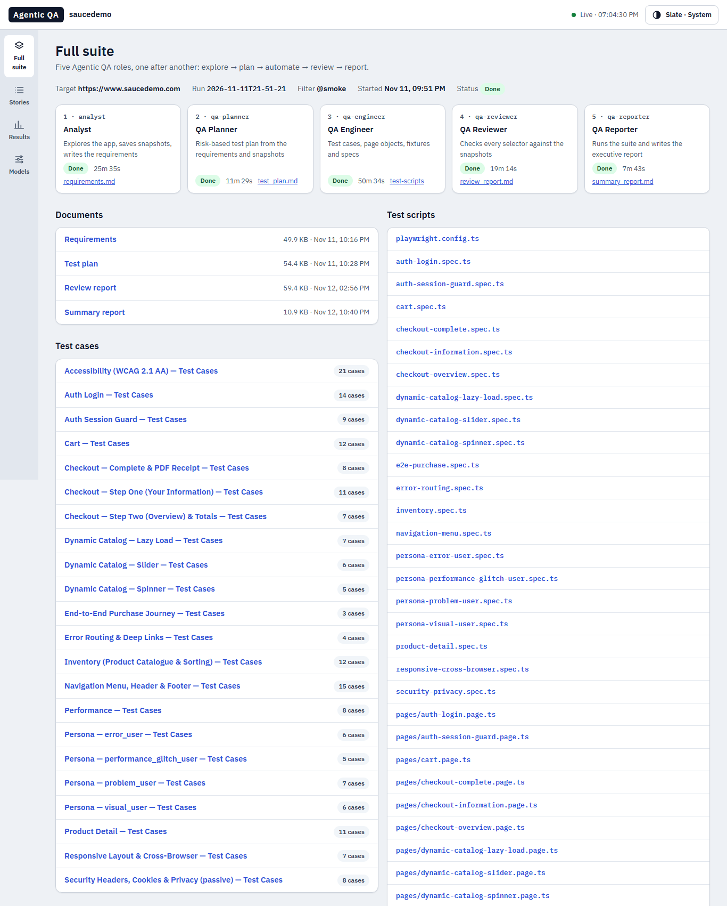
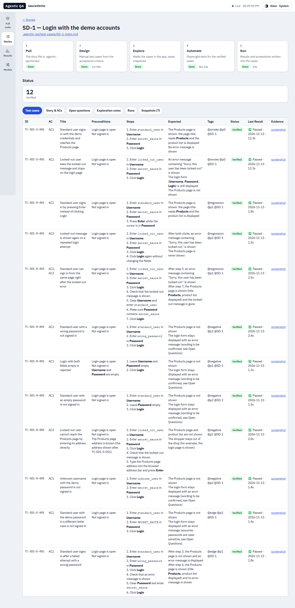
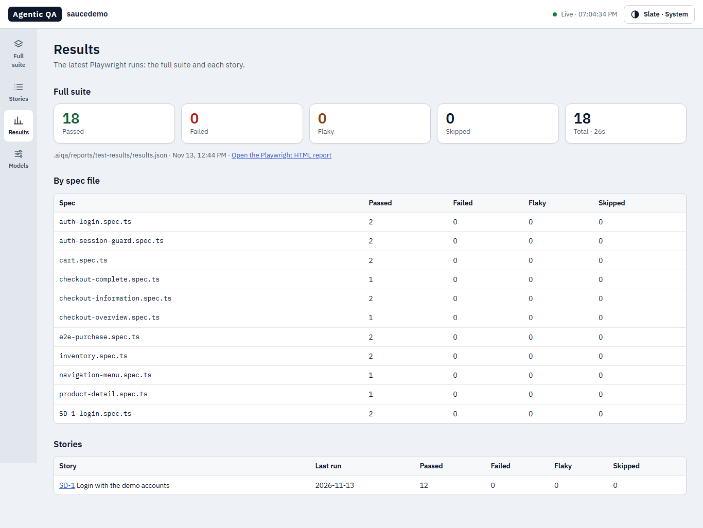
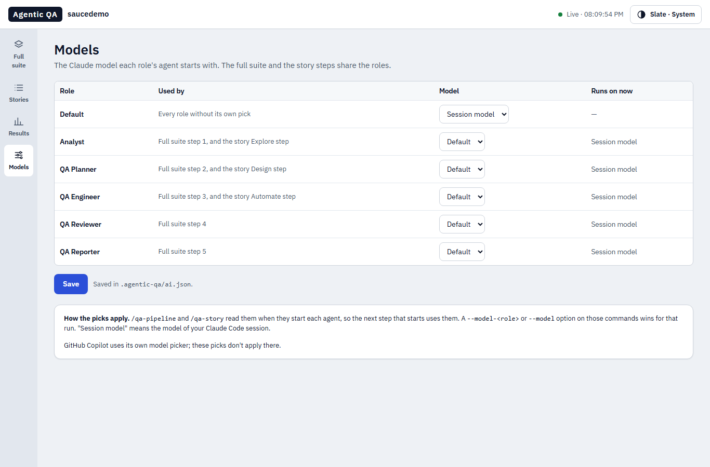

# Example: a real run on saucedemo.com

This is a real run of the Agentic QA agents on [saucedemo.com](https://www.saucedemo.com), the public demo shop by Sauce
Labs. It shows the commands, what each step wrote, how long each step took, and the dashboard.

The run's own files (`.aiqa/…`) aren't in this repository. This page quotes short parts of them.

| | |
|---|---|
| Dates | 11–12 November 2026 |
| Tool | Claude Code 2.1.322, with Agentic QA installed as a plugin from this repository |
| Model | Claude Opus 5.5 for every agent (see [Models](#models)) |
| Browser | Chromium, through `playwright-cli` and Playwright 1.61.0 |

The run used the plugin's earlier name, `aiqa`. The commands on this page use its current name, `agentic-qa`.

## Setup
In an empty folder:
```
npm init -y
npm install -D @playwright/test
npx playwright install chromium
claude plugin marketplace add qa-crew/agentic-qa --scope project
claude plugin install agentic-qa@qa-crew --scope project
```
`playwright-cli` was already installed (`npm install -g @playwright/cli@latest`). Instead of the first three lines,
you can install the plugin and then run `/agentic-qa:qa-setup`, which asks and installs the same things.

This run installed the plugin from a local copy of this repository. Some steps ran headless with `claude -p`, so
the folder's `.claude/settings.local.json` allowed the commands the agents use (`playwright-cli`, `npx`, `node`,
file reads and writes), as `qa-setup` suggests.

## The full suite
```
/agentic-qa:qa-pipeline https://www.saucedemo.com --grep @smoke --auto
```
`--auto` runs all five steps without pausing. `--grep @smoke` makes the reporter run only the quick smoke tests.

| Step | Time | What it wrote |
|---|---|---|
| 1 · Analyst | 25 min 35 s | 56 page snapshots, and requirements (51 KB): 13 user journeys, 61 functional and 29 non-functional requirements |
| 2 · QA Planner | 11 min 29 s | A test plan (56 KB): 22 feature areas, risks, test data, entry and exit rules |
| 3 · QA Engineer | 50 min 34 s | 22 test-case files with 192 cases; `playwright.config.ts`, fixtures, 20 page objects and 20 specs with 197 tests (16 tagged `@smoke`) |
| 4 · QA Reviewer | 19 min 14 s | A review report (61 KB): **passed with warnings**, 0 critical issues, 11 warnings, 13 suggestions |
| 5 · QA Reporter | 5 min 0 s | The summary report: **passed**, 16 of 16 smoke tests in 35 seconds |

That's about 1 hour 52 minutes of agent time.

### How the run actually went
The steps didn't all run in one go:
- The first try ran in one `claude -p` call with a 58-minute time limit. The limit stopped it during step 3, after
  the QA Engineer had written 18 test-case files.
- The next try hit the Claude Pro plan's usage limit. Steps 1 to 3 with Opus on every role used up most of one
  5-hour window.
- After the limit reset, the last three steps were run one at a time. A step name runs just that step, as part of
  the last run, so the dashboard still shows one run:
  ```
  /agentic-qa:qa-pipeline qa-engineer --grep @smoke
  /agentic-qa:qa-pipeline qa-reviewer
  /agentic-qa:qa-pipeline qa-reporter --grep @smoke
  ```
  The QA Engineer kept 13 test-case files from the earlier try, changed 5 and added 4.

**Tip:** on a Pro plan, expect a full run to need more than one usage window. Running steps one at a time, or
picking a lighter model for some roles, helps.

### Step 1 · Analyst
It logged in as each demo user, walked every page and saved an accessibility snapshot of each page and state. Then
it wrote the requirements, each one linked to the snapshot that shows it:

| ID | Requirement | MoSCoW | Evidence | Status |
|---|---|---|---|---|
| FR-002 | A valid username with password `secret_sauce` shall log the user in and redirect to `/inventory.html` | Must | post-login-inventory.yml | Met |
| FR-006 | Locked accounts (`locked_out_user`) shall be refused with "Epic sadface: Sorry, this user has been locked out.", including when a session cookie is injected | Must | login-error-locked-out.yml | Met |
| FR-013 | A logged-in user who opens `/` should be sent to `/inventory.html` or shown their session state | Could | (eval) | Not met. The login form is shown again |

### Step 2 · QA Planner
It turned the requirements into a plan by risk. Two of its risks, which later shaped the tests:

| # | Risk | Likelihood | Impact | Mitigation |
|---|---|---|---|---|
| R-02 | Cart leaks between users and tests through localStorage surviving logout | High (DEF-002) | High | New browser context per test; never share storage state across personas |
| R-03 | Stale saved auth state (cookie about 10 min) causes mass "redirect to login" failures | High | High | Log in via a setup project per run; never commit or reuse `.aiqa/auth-state.json` |

### Step 3 · QA Engineer
It wrote the test cases first, then page objects and specs that use names from the snapshots. A test case:

| ID | Title | Preconditions | Steps | Expected Result |
|---|---|---|---|---|
| TC-LOGIN-S-002 | Locked-out user is refused | Guest on `/` | 1. Open `/` 2. Enter `locked_out_user` / `secret_sauce` 3. Click "Login" | Alert reads "Epic sadface: Sorry, this user has been locked out."; URL stays `/` |

Its page object and test:
```ts
// pages/auth-login.page.ts
this.usernameInput = page.getByRole("textbox", { name: "Username" });
this.passwordInput = page.getByRole("textbox", { name: "Password" });
this.loginButton = page.getByRole("button", { name: "Login" });
this.errorAlert = page.getByRole("alert");
```
```ts
// auth-login.spec.ts
test("TC-LOGIN-S-002 — Locked-out user is refused @smoke @regression @p0", async ({ page, authLoginPage }) => {
  await authLoginPage.goto();
  await authLoginPage.login("locked_out_user");
  await expect(authLoginPage.errorAlert).toHaveText("Epic sadface: Sorry, this user has been locked out.");
  await expect(page).toHaveURL("/");
});
```
It ran the whole suite on Chromium: all 197 tests ended as expected. 24 of them are expected to fail
(`test.fail()`), because they check defects the agents found in the app. For example:
- a made-up product id can still be added to the cart: the badge counts it, but the cart doesn't list it;
- the cart survives logout, so the next user sees it;
- checkout works with an empty cart, and accepts names made of spaces;
- an unknown address shows no 404 page.

It also noticed that the saved login from step 1 had expired, so the tests log in through the login page instead.

Two modules weren't written: accessibility and performance. They're written only when `--grep` includes
`@accessibility` or `@performance`, and accessibility also needs `@axe-core/playwright`.

### Step 4 · QA Reviewer
It checked every selector against the snapshots and every test case against the specs:

| Measure | Result |
|---|---|
| Selector validation | 107 locators in 20 page objects. 63 role and text locators all match their snapshots (0 mismatches). 38 `data-test` locators can't be checked against snapshots, and all passed in the last run |
| Traceability | 163 of 192 test cases automated: all of the 20 generated modules. The other 29 are in accessibility and performance |
| Fixed delays | None |

Its top warnings:
- the two missing modules;
- `playwright.config.ts` loads the saved login into every test, which the plan's risk R-03 says not to do;
- one test waits for `networkidle`, which can make it flaky.

### Step 5 · QA Reporter
It ran the smoke tests and wrote the summary for a reader who won't open the code:

> **Bottom line:** all 16 `@smoke` tests passed on Chromium in 35.1 s, with no failures, flaky tests or skips. The
> core purchase path works end to end: login, session guard, menu, inventory, product detail, cart, the three
> checkout steps, and the full purchase journey.

| Passed | Failed | Skipped | Flaky | Total | Duration |
|---|---|---|---|---|---|
| 16 | 0 | 0 | 0 | 16 | 35.1 s wall clock (55.2 s total test time, 2 workers) |

The report also lists what the run didn't cover: the 181 other tests, Firefox, WebKit and mobile, and accessibility
and performance.

Claude Code doesn't let a subagent write a file named `summary_report.md`, so the reporter returns the report and
`qa-pipeline` saves it.

## One story: SD-1
The same folder, after the full suite. The story file `.aiqa/stories/SD-1-login.md`:
```markdown
---
key: SD-1
title: Login with the demo accounts
---
# SD-1 — Login with the demo accounts

## Description
As a shopper I want to sign in so I can buy things.

## Acceptance Criteria
- A standard user reaches the products page
- A locked-out user sees "Sorry, this user has been locked out."
```
Then:
```
/agentic-qa:qa-story SD-1 --url https://www.saucedemo.com --auto
```

| Step | Time | What happened |
|---|---|---|
| Design | 1 min 44 s | 2 testable acceptance criteria, 9 open questions, and 12 test cases |
| Explore | about 7 min | All 12 cases walked in the app and marked Verified; 7 snapshots; no possible defects |
| Automate | 4 min 13 s | A spec with 12 tests tagged `@SD-1`, using the suite's login page object |
| Run | 19 s | 12 passed; results and screenshots written into the test-case file |

The usage limit stopped the first try just as Explore finished. Running the same command again went on from
Automate, because Design and Explore were already done.

### Design
It rewrote each criterion so it can be tested:

> **AC2** — Given the login page is open and the shopper is not signed in, when they enter the locked-out demo
> username `locked_out_user` and the demo password `secret_sauce` and click **Login**, then the login page stays
> displayed with an error message containing "Sorry, this user has been locked out." and the Products page is not
> shown.

It also listed what the story leaves open, for example:

> The story does not say whether username and password are case-sensitive or whether leading or trailing spaces are
> trimmed.

The test cases use the 11-column table that the npm package reads (shown here after the Run step):

| ID | AC | Title | Preconditions | Steps | Expected | Tags | Status | Last Result | Evidence | ALM |
|---|---|---|---|---|---|---|---|---|---|---|
| TC-SD1-S-002 | AC2 | Locked-out user sees the locked-out message and stays on the login page | Login page is open<br>Not signed in | 1. Enter `locked_out_user` in **Username**<br>2. Enter `secret_sauce` in **Password**<br>3. Click **Login** | An error message containing "Sorry, this user has been locked out." is shown<br>The login form (**Username**, **Password**, **Login**) is still displayed<br>The Products page is not shown | @smoke @p0 @SD-1 | Verified | ✅ Passed · 2026-11-12 · 1.7s | screenshot | — |

### Explore
It ran every case with `playwright-cli` and checked some open questions on the way:
- `locked_out_user` with a wrong password gets the "do not match" error, not the locked-out one;
- spaces around the username are not trimmed;
- the password is case-sensitive.

### Automate and Run
The spec's test titles start with the test-case ids, so the Run step can write each result back to its row:
```ts
test("TC-SD1-S-002 — Locked-out user sees the locked-out message and stays on the login page", {
  tag: ["@smoke", "@p0", "@SD-1"],
  annotation: story,
}, async ({ page, authLoginPage, inventoryPage }) => {
  await authLoginPage.goto();
  await authLoginPage.login("locked_out_user", PASSWORD);
  await expect(authLoginPage.errorAlert).toContainText(LOCKED_OUT);
  // …
```
The Run step filled in **Last Result** and **Evidence** for every row, and added a row to **Run History**.

### Same files as AIQA
AIQA's `stories status` (run here from the npm package's source) reads the story that the agents wrote:
```
   Story        Title                                        Manual   Auto   Last run
✅   SD-1         Login with the demo accounts                 12       12     12✓ 0✗ 2026-11-12
```
Its "Last run" column needs the package's story index (`.aiqa/stories/index.json`). The first `stories status`
creates it; after that, each story run is recorded there too.

## The dashboard
`/agentic-qa:qa-dashboard` showed the run live. The full suite, with each step's time and files:



The story, with each step's time and every test case's latest result:



The latest Playwright runs. The smoke tests were run once more after the story (see
[Fixed after this run](#fixed-after-this-run)), so this view shows 18 tests: the suite's 16 and the story's 2 smoke
cases, which live in the same folder. The story's own run is listed below them:



## Models
No model picks were saved, so every agent ran on the Claude Code session's model, Claude Opus 5.5. The Models page
shows that each role uses the session model:



To try a lighter model for some roles, pick it on this page and press Save, or pass it for one run, e.g.
`--model-qa-reporter sonnet`.

## Fixed after this run
The run showed three problems in the agents, which were then fixed in this repository:
- **The saved login applied to every test.** The QA Engineer's `playwright.config.ts` loaded `.aiqa/auth-state.json`
  into every test, against the plan's own risk R-03. Here the saved login had expired, so no test was affected. With
  a fresh one, login tests would have started signed in. Now the config never loads it, and tests that need a
  signed-in user use a sign-in fixture.
- **Story runs didn't know the suite's test-id attribute.** The suite's config reads element ids from `data-test`.
  The story config didn't, so the shared page objects' `getByTestId` found nothing in a story run, and the SD-1 spec
  had to set it itself. Now the story config copies the setting from the project's config.
- **Listing the tests erased the latest results.** The story Automate step and the QA Reporter each ran
  `npx playwright test --list` to count tests. With the suite's config, that rewrote the JSON and HTML reports with
  every test marked "skipped". This is why the smoke tests were run once more before the screenshots were taken.
  Now the config uses the plain list reporter for `--list`, and the prompts give the safe command.

All three fixes were checked on this run's files: a `--list` left the reports unchanged, the 18 smoke tests passed
without the saved login, and SD-1 passed 12 of 12 without its own `data-test` setting.
